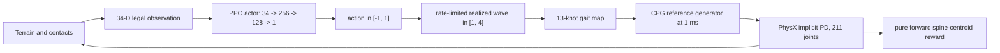

# PI Master Runbook

## 1. 先用一句话理解项目

这是一个 21 节主躯干、19 对腿、211 个主动关节的蜈蚣仿真。底层 CPG 每 1 ms 生成关节位置/速度参考，PhysX implicit PD 执行参考；RL 每 12 ms 只输出一个标量，用来调整空间 wave number。RL 不直接控制 211 个关节。



## 2. 什么是唯一主线

| 层 | 唯一实现 | 不存在的旧分支 |
|---|---|---|
| 模型 | `assets/centipede_rebuild_v1_renamed.usd` + 4 个 layer | alternate model、旧 MJCF wrapper |
| 索引 | `centipede/model.py` | regex 猜 joint、兼容命名分支 |
| 地形/arena | `centipede/terrain.py` | 旧 `arena.py`、transition 拼接器、agent 临时 terrain helper |
| 步态参数 | `config/gait_map.json` | 多代 winner YAML、P7/BO 参数库 |
| CPG | `centipede/controller.py` + `config/controller.yaml` | oracle、monkeypatch、Stage-E |
| 环境 | `centipede/env.py` + `centipede/env_cfg.py` | 历史 reward/observation 开关 |
| RL | `scripts/train.py` + `config/rl_games.json` | 多 reward、旧 action remap、不同 updaterate 分支 |
| 评估 | `scripts/evaluate.py` | receipt/guardian/recovery/attempt 系统 |
| sweep | `scripts/open_loop_sweep.py` | P7 Bayesian optimization |

旧项目仍保留作 provenance，但 clean 项目运行时不 import 旧项目的项目代码。当前 conda 环境中的 Isaac Lab 本身是 editable external dependency，仍指向旧 checkout；正式长期使用时应把 Isaac Lab v2.2.1 安装到中立依赖目录。

## 3. 冻结契约

| 项 | 值 |
|---|---|
| Isaac Sim | 5.0.0 |
| Isaac Lab | v2.2.1, commit `0f00ca2b4b2d54d5f90006a92abb1b00a72b2f20` |
| Python / Torch | 3.11 / 2.7.0+cu128 |
| Physics dt | 0.001 s |
| RL/control period | 0.012 s = 12 physics substeps |
| Episode | 9.6 s = 800 policy steps |
| Default parallel envs | 32；它们是并行确定性条件，不是 32 个独立 replicate |
| Observation | 34D |
| Action | 1D，范围 `[-1,1]` |
| Wave target | `2.5 + 1.5 * action`，因此范围 `[1,4]` |
| Wave reset | 2.5 |
| Command dynamics | tau 0.25 s，最大变化率 3.5 wave/s |
| Reward | 61-link spine centroid 的逐步净 `-x` 位移 / 0.1025 m |
| Active joints | 211 |
| Metric spine links | 61，非质量加权 |

## 4. 第一次接手：按顺序执行

### 4.1 打开环境和目录

```powershell
conda activate isaaclab_50
cd C:\Users\wxy22\Documents\Centipede_IsaacLab_RL_Clean
```

看到命令行左侧有 `(isaaclab_50)` 才继续。

### 4.2 快速完整性检查

不重建大地形的快速检查：

```powershell
python scripts\check_project.py --quick
```

预期最后一行：

```text
CLEAN_PROJECT_CHECK: PASS
```

完整检查会重建 1536 x 1536 tri terrain 并核对 source/collision hash：

```powershell
python scripts\check_project.py
```

### 4.3 CPU 单元测试

```powershell
pytest -q
```

冻结版本预期：`5 passed`。测试覆盖 action law、13-knot gait map、1,800 substep controller golden sequence、tri-terrain hash 和 3 个 checkpoint 的 34D/1D 接口。

### 4.4 GPU 所有权检查

不要和另一个 Isaac、训练或渲染进程并发。先检查：

```powershell
nvidia-smi
```

如果显示 Python/Isaac 占用大量显存，先确认它是谁。不要因为想跑 smoke 就直接结束未知进程。

### 4.5 最小 Isaac smoke

只启动 1 个环境，平地，固定 wave=2.5，20 个 policy steps，也就是 0.24 s：

```powershell
python scripts\evaluate.py --terrain flat --fixed-wave 2.5 --num-envs 1 --steps 20 --headless --out outputs\smoke
```

成功标准：

- Isaac 正常启动并自动关闭。
- 终端输出一份 JSON。
- `survivors` 为 1。
- 没有 NaN、missing joint、observation shape drift 或 contact sensor 错误。
- 结果位于 `outputs\smoke\flat\terrain_seed_244949\open_loop_w2.5\metrics.json`。

20 steps 只能证明链路能跑，不能评价 locomotion。

## 5. 生成第一个 demo

clean handoff 已保留一组三条件 canonical demo，PI 第一次接手无需重跑，
直接打开：

```text
outputs\demo\flat\terrain_seed_244949\open_loop_w1.5\video\high_fidelity\high_fidelity_45deg.mp4
outputs\demo\l90a8\terrain_seed_244949\open_loop_w2\video\high_fidelity\high_fidelity_45deg.mp4
outputs\demo\l60a12\terrain_seed_244949\open_loop_w3\video\high_fidelity\high_fidelity_45deg.mp4
```

三条对应 flat/wave1.5、mild L90/A8/wave2.0 和 rough L60/A12/wave3.0。
汇总索引为 `outputs/demo/TERRAIN_DEMO_PANEL_20260818.json`；每个 run 的
metrics、trace、binding JSON 和 audit JSON 均在同一目录。下面命令用于
从零复现或生成新条件，而不是寻找另一个“最新版”。

### 5.1 平地固定低波 open-loop

800 steps = 9.6 s：

```powershell
python scripts\evaluate.py --terrain flat --fixed-wave 1.5 --num-envs 1 --steps 800 --video --headless --out outputs\demo
```

这是内部核验视频：Isaac 不启动相机，只记录每个 link 的世界位姿；退出仿真前自动调用第三方离线渲染器。视频位于：

```text
outputs\demo\flat\terrain_seed_244949\open_loop_w1.5\video\offline_45deg.mp4
```

同目录还有 `offline_45deg.audit.json`。上一级保存 `metrics.json`、`traces.npz` 和可复核的 `all_link_world_poses.npz`。视频无标签、无黑边。

### 5.2 rough 固定高波 open-loop

```powershell
python scripts\evaluate.py --terrain l60a12 --fixed-wave 3.0 --num-envs 1 --steps 800 --video --headless --out outputs\demo
```

### 5.3 retained RL policy demo

```powershell
python scripts\evaluate.py --terrain l60a12 --policy-seed 161803 --num-envs 1 --steps 800 --video --headless --out outputs\demo
```

这时 action 来自 checkpoint，wave 从 2.5 开始，经 rate limit/lag 变化。视频本身不叠字；实时 wave 的数值在 `traces.npz`。

### 5.4 把任意已录轨迹换成高保真真实外观

此步骤不占 GPU、不重跑动力学；它只用 Blender 把高模皮肤绑定到现有 251-link 世界位姿：

```powershell
python scripts\render_high_fidelity.py `
  --alllink-npz outputs\demo\flat\terrain_seed_244949\open_loop_w1.5\all_link_world_poses.npz `
  --out-dir outputs\demo\flat\terrain_seed_244949\open_loop_w1.5\video\high_fidelity
```

先看 `high_fidelity_alignment.png` 核对头尾、腿段和触须，再看 `high_fidelity_45deg.mp4`。最终必须确认 `high_fidelity_45deg.audit.json` 中 `pass=true`、`physics_unchanged=true`、`collision_unchanged=true`、`source_hue_preserved=true`，并确认 binding 中 `head_visual_group_complete=true`、`head_visual_pitch_raised=true`、`head_visual_hinge_preserved=true`。当前正式装配把源头壳的 `-5.838°` 视觉俯角校正到 `+8.094°`，但不改 head link 或 collision。完整原理和故障门槛见 `docs/05_VIDEO_RENDERING_PLAYBOOK.md`。

## 6. 从小到大重跑 open-loop landscape

先跑 3 个 wave、1 个 terrain seed、3 个地形，不要一上来跑默认 156 cells：

```powershell
python scripts\open_loop_sweep.py --terrains flat l90a8 l60a12 --terrain-seeds 244949 --waves 1.5 2.5 3.5 --out outputs\pilot_sweep
```

这是 9 次独立 Isaac 启动。每个 cell 默认 32 env。脚本故意一个 cell 一个进程，代价是慢，收益是任何 GPU/PhysX 污染不会跨 cell 持续。

默认全 panel 是：

```text
6 terrains x 2 terrain seeds x 13 waves = 156 Isaac boots
```

不要把每个 boot 内的 32 env 当 32 个独立随机重复。科学独立性主要来自 terrain seed、policy seed 和预先定义的 spatial strata。

## 7. 训练一个新 policy

先做 1 epoch 接口试跑：

```powershell
python scripts\train.py --seed 314159 --epochs 1 --num-envs 32 --headless --out outputs\train_smoke
```

正式复现 24 epoch：

```powershell
python scripts\train.py --seed 161803 --epochs 24 --num-envs 32 --headless --out outputs\train
```

训练地形不是 homogeneous 单地形，而是一个 tri terrain：flat、L90/A8、L60/A12 三条纵向 strip。每次 reset 先随机选 strip，再在固定 x 位置、对应 strip 中心 y 位置 spawn。

## 8. 输出目录怎么读

`outputs/` 被 `.gitignore` 排除，任何运行产生的内容都不会改变 clean source contract。交付时保留 `outputs/demo/` 下的 canonical 三条件 panel；新的 smoke、sweep 和 training 输出应写到新的 run 名，不要覆盖这三条 run。

评估单元目录：

```text
outputs/<run>/<terrain>/terrain_seed_<seed>/<open_loop_wX|policy_seed_X>/
    metrics.json
    traces.npz
    all_link_world_poses.npz       # 仅 --video 时，251-link 世界位姿
    video/
        offline_45deg.mp4          # 仅 --video 时
        offline_45deg.audit.json
```

`metrics.json` 重点字段：

| 字段 | 含义 | 不能误读成 |
|---|---|---|
| `survivors` | 完整跑到指定 steps 的 env 数 | 所有 env 都是独立重复 |
| `survival_rate` | survivors / num_envs | 普适生物存活概率 |
| `survivor_speed_bl_cycle` | 仅 survivor 的全时长净位移 / 时间 / body length | 失败样本的速度 |
| `survivor_speed_median_bl_cycle` | survivor speed 的中位数 | 全样本均值 |
| `first_done_step` | 首次 failure/truncation step，未 done 为 -1 | failure 原因诊断 |
| `episode_return` | 每步 pure-forward reward 之和 | 和 speed 完全等价；reset/terminal masking 会造成差异 |

`traces.npz`：

- `wave[time, env]`：实际送入 gait map 的 realized wave。
- `reward[time, env]`：逐 policy-step reward。
- `alive[env]`：评估结束时是否从未 done。
- `first_done_step[env]`：首次 done 时刻。

## 9. 现有科学结果应怎样表述

### 9.1 Open loop

- P13 完成 72/72 GPU cells。
- 预注册总判决：`CONDITIONAL_LOCAL_OR_CALIBRATION_DEPENDENT`。
- 几何路径 endpoint wave 从 flat 到最 rough 增加 2.0，但路径不是单调。
- hierarchical bootstrap 的 `P(endpoint rough > flat)=0.806`，没有达到 0.95 门槛。
- fixed-lambda 正趋势 3/5，要求 4/5；fixed-amplitude 正趋势 2/4，要求 3/4。
- 因而可说存在局部/条件性 rougher-to-higher 现象，不能说全局规律已经证实。

### 9.2 Observation

- 34D 中排除 wave 和 CPG phase 后的 31D scientific subset，在 1.44 s snapshot 上完成 roughness 3-class seed+wave double holdout。
- whole-boot balanced accuracy = 0.9444，最低类别 recall = 0.8333，exact label permutation p = 0.0333。
- phase-only negative control = 0.3333。
- 这证明 tested panel 中存在可线性读取的地形相关信息。
- 它不证明能完整重建地形，不证明任意 terrain generalization，也不证明 PPO 实际用了这些维度。

### 9.3 Closed loop

三个 epoch-24 checkpoint 被保留，但 P13 policy-seed x terrain-seed closed-loop matrix 在迁移时未完成。因此 clean release 不携带“RL 已证明 rougher -> higher”的最终结论。

## 10. 常见故障按这个顺序排

### `Missing locked file` / `Hash drift`

先不要运行仿真。说明 source contract 被改过、文件丢失或文档新增后没有更新 lock。比较 `provenance/SOURCE_LOCK.json`，不要随手把新 hash 当正确答案。

### `Frozen model is missing joint/body`

USD 或模型命名变了。不要改 `ModelIndex` 去适配未知模型；先确认是否错误加载了 alternate USD。

### `Expected 211 active joints` / `61 spine links`

模型拓扑不再是支持的那一套。属于硬停止，不是 warning。

### `Observation shape drift` 或 NaN/Inf

停止训练。先检查 contact sensor、body names、spine geometry、root quaternion 和 reset/spawn。不能用 clip 把 NaN 掩掉。

### 一开始就翻转

先看 `first_done_step` 是否非常小，再检查 footprint 下最高 collision height + 0.025 m clearance。不要把 spawn penetration 当运动中动力学 buckle。

### 速度符号看起来反了

该模型 canonical forward 是 world `-x`，所以 reward 使用负号。先核对视频朝向，不要直接删负号。

### RL wave 不到 action target

这是预期的 command dynamics：action 先映射 target，再经过 0.25 s 一阶过程和 3.5 wave/s rate limit。检查 `traces.npz` 的 realized wave，而不是只看 policy 原始 action。

## 11. 修改纪律

1. 先复制整个 clean 目录或创建 git commit，再改。
2. 一次只改一个层：model、terrain、gait/controller、observation/reward、RL config 不混改。
3. 改前写假设和可证伪指标；改后先 `check_project --quick` 和 tests。
4. 模型/terrain/controller 改动必须有新的 golden/hash，不得覆盖旧 hash 后声称 bit-identical。
5. 每个 GPU 运行目录必须新建，不覆盖已有 metrics/traces/video。
6. 生存和 survivor-conditioned speed 分开报告；无 survivor 的 cell 没有合法速度。
7. 不把 32 parallel envs 称为 32 replicates。

## 12. PI 最短接手路线

第一天只做五件事：

1. 阅读本文件和 `03_OBSERVATION_REWARD_ACTION_REFERENCE.md`。
2. 运行完整 `check_project.py` 与 `pytest -q`。
3. GPU 空闲时跑 1-env 20-step smoke。
4. 生成 flat wave1.5、L60/A12 wave3.0、L60/A12 policy161803 三个 9.6 s demo。
5. 对照 `04_RESULTS_AND_DEMO_GUIDE.md` 核验视频与 metrics，不立即重启大 sweep。
