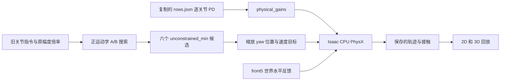

# 六波数幅度与 PD 的实际来源核对

2026-09-28。本次读取原源码、运行清单、参数快照和保存的数组；没有运行搜索、物理仿真或渲染，没有修改原项目、PD 或 Clean。

**这组六幅度是理想关节姿态下的几何优化结果，搜索时不执行 PD 动力学。随后实际 demo 使用另一条参数加载链；该链遗漏了波数 2.5、3.5 的 front5 渐变增益覆盖。** 因而不能描述为“在完整采用此前 front5 PD 的六波数动力学优化中得到的幅度”。

## 1. 幅度究竟怎样计算

- 搜索主程序：[optimize.py，run()](C:/Users/wxy22/Documents/Codex/2026-09-15/ni/work/stride_cluster_joint_2026-09-21/optimize.py:9)。每个波数独立搜索 A（body yaw）和 B（leg yaw），没有跨波数单调约束。
- 几何与目标函数：[stride_cluster_geometry.py，Geometry](C:/Users/wxy22/Documents/Codex/2026-09-15/ni/work/stride_cluster_joint_2026-09-21/stride_cluster_geometry.py:11)；[metrics() 的 RMS 计算](C:/Users/wxy22/Documents/Codex/2026-09-15/ni/work/stride_cluster_joint_2026-09-21/stride_cluster_geometry.py:75)。
- 分组规则：[screen.py，clusters()](C:/Users/wxy22/Documents/Codex/2026-09-15/ni/work/leg_cluster_2026-09-21/screen.py:12)。按原身体中线曲率符号选择内侧腿，排除头尾不完整组；每个相位的成员固定，候选不能靠减少脚数改善指标。

Geometry 从 [practical trial 的 rows.json](C:/Users/wxy22/Documents/Codex/2026-09-15/ni/work/practical_trial_2026-09-21/practical20260921_trial1_job0/rows.json) 选择原表第 0、5、10、15、20、25 行；读取这些行指向的 [commands_12s.npz](C:/Users/wxy22/Documents/Codex/2026-09-15/ni/work/world_pitch_front2_12s_2026-09-16/commands_12s.npz)，按关节名称重新排序，再乘原行的 body／leg_yaw／leg_pitch 幅度倍率。它不是从零重写一套正弦指令。

body 与 leg yaw 分别再乘 A/baseA 和 B/baseB；baseA/baseB 是原缩放指令从 4 秒起的峰值角度。保留原相位、波形、前端包络及其余关节指令。

目标为各完整凹弯段内侧全部足尖的二维方差，先在组内平均，再在相位／组实例之间等权平均，最后开根号。代码是 `rms_mm = sqrt(v.mean()) * 1000`。包含未触地的脚，没有用实际接触力或速度评分。

身体粗网格为 2–min(35.5, joint-limit bound)°，25 档并加入原幅度；腿为 0–min(75, joint-limit bound)°，61 档。在腿幅度局部谷底用 bounded minimize_scalar 细化，再在较好身体幅度附近 ±1.4° 加 9 档进行一轮细化。代码还为另一支带几何筛查的候选细化边界；本次六节点取的是 [chosen.unconstrained_min](C:/Users/wxy22/Documents/Codex/2026-09-15/ni/work/stride_cluster_joint_2026-09-21/optimize.py:48)，不要求通过间距／交叉筛查。

搜索用一个周期的 84 个相位点，另用 200 个错开相位点复核。每波数保留 2624–2638 条评估记录；这是保存记录数，不声称是无重复的函数调用数。六个选中点均为各自记录中的最小 RMS，且均为 `geometry_clear=false`。

[run_mujoco.py 的 model()](C:/Users/wxy22/Documents/Codex/2026-09-11/con/terrain_surface_library_2026-09-15/run_mujoco.py:9) 只向 Geometry 提供模型；Geometry 设置 qpos 后调用 mj_kinematics，并用轴旋转公式加速足尖位置计算。该路径没有调用 run_mujoco.run()、mj_step() 或 physical_gains()。它不计算 PD 跟踪误差、接触受力、world-pitch 反馈产生的实际姿态或被动关节的受力变形。

## 2. 搜索结果怎样进入实际运行

[prepare_primary.py](C:/Users/wxy22/Documents/Codex/2026-09-15/ni/work/leg_pitch_duty_2026-09-22/prepare_primary.py:8) 复制此前 stridecluster baseline 的 rows.json、worker.py、world_feedback.py 和 ablation_contract.py，然后从 GEOMETRY.json 的 `chosen.unconstrained_min` 提取六个候选。它把 `body_factors`、`leg_cluster_factors` 与 `joint_cells` 写入新 plan.json，没有重新设计／调整 PD。

[run_primary1.py](C:/Users/wxy22/Documents/Codex/2026-09-15/ni/work/leg_pitch_duty_2026-09-22/run_primary1.py:21) 启动 [当时实际执行的 worker.py](C:/Users/wxy22/Documents/Codex/2026-09-15/ni/work/leg_pitch_duty_2026-09-22/pitchduty20260922_primary1/worker.py:41)，通过 --rows 和 --experiment-plan 指向同目录快照。保存的 manifest 记录实际为 CPU、12 秒、1 ms、32/16；旧 plan 顶层残留的 64 字段不是实际启动值。

[worker 的幅度缩放](C:/Users/wxy22/Documents/Codex/2026-09-15/ni/work/leg_pitch_duty_2026-09-22/pitchduty20260922_primary1/worker.py:204) 先通过 [CommandCache](C:/Users/wxy22/Documents/Codex/2026-09-11/con/open_loop_review_2026-09-16/optimization/command_cache_nonnegative.py:11) 读取旧 q/v 指令与原行倍率，再将 body yaw、leg yaw 的位置和速度目标分别乘以新因子。新幅度不写回 rows 的旧 `amplitudes` 字段，也没有传入 physical_gains，因此只读 rows 中的 amplitudes 会误读实际指令。

| 波数 | demo 环境号 | 原表行号 | A 身体 (°) | B 腿 (°) | front5 与旧 firm20 是否一致 |
|---:|---:|---:|---:|---:|---|
| 1.5 | 0 | 0 | 32.0083 | 24.7026 | 是 |
| 2 | 1 | 5 | 27.8208 | 29.0004 | 是 |
| 2.5 | 2 | 10 | 22.2417 | 34.9760 | 否，漏覆盖 |
| 3 | 3 | 15 | 17.7042 | 33.3329 | 是 |
| 3.5 | 4 | 20 | 7.5833 | 43.2880 | 否，漏覆盖 |
| 4 | 5 | 25 | 2.6990 | 41.8512 | 是 |

## 3. PD 的数据来源和导入函数

**最终数值来源**是 [primary1/rows.json](C:/Users/wxy22/Documents/Codex/2026-09-15/ni/work/leg_pitch_duty_2026-09-22/pitchduty20260922_primary1/rows.json) 每行的 `absolute_joint_pd`，全部 173 个关节都有 Kp/Kd。六行的 `family_multipliers` 都为空。

导入链：[worker.py 导入 common](C:/Users/wxy22/Documents/Codex/2026-09-15/ni/work/leg_pitch_duty_2026-09-22/pitchduty20260922_primary1/worker.py:29) → [common.py 导入 physical_gains](C:/Users/wxy22/Documents/Codex/2026-09-11/con/terrain_surface_library_2026-09-15/common.py:10) → [experiment.py 的 physical_gains()](C:/Users/wxy22/Documents/Codex/2026-09-11/con/round9_wave_amplitude_2026-09-14/experiment.py:13)。physical_gains 只按运行时关节名称读取 row.absolute_joint_pd，乘可选家族倍率，转成 float32。

[worker.py 第 146 行](C:/Users/wxy22/Documents/Codex/2026-09-15/ni/work/leg_pitch_duty_2026-09-22/pitchduty20260922_primary1/worker.py:146) 将 Kp/Kd 写入物理引擎；随后同步 Isaac actuator 对象，并在第 150 行用原生 getters 断言实际值与写入值完全一致，才保存 backend.npz。初始化时来自 mapping.json 的 kp0/kd0 随后被这一操作覆盖，因此不能把 mapping.json 当作最终有效 PD。

较早基础 PD 来自 [Round9 selected_rows.json](C:/Users/wxy22/Documents/Codex/2026-09-11/con/round9_wave_amplitude_2026-09-14/selected_rows.json)，经 [9 月 16 日 baseline 32 行表](C:/Users/wxy22/Documents/Codex/2026-09-11/con/open_loop_review_2026-09-16/optimization/baseline_profile_v2_n32/baseline_resource_v2_n32_batch00_rows.json) 继承。本次逐波数检查确认两者的全部逐关节基础 PD 相等。

后加的 front5 规则来自 [prepare_front5_soft.py](C:/Users/wxy22/Documents/Codex/2026-09-15/ni/work/prepare_front5_soft.py:6) 和 [prepare_front5_firm20.py](C:/Users/wxy22/Documents/Codex/2026-09-15/ni/work/prepare_front5_firm20.py:5)：先从原头端 Kp 的 20% 几何递减到第五关节的普通身体 Kp，Kd 按相对刚度平方根缩放；再使第 i 节 Kp 乘 1.2**(1-i/4)，Kd 乘其平方根。9 月 17 日完整粗糙地形 CPU demo 使用这组 firm20 渐变值。

当前 body yaw／leg yaw 的 PD 继续使用各自旧波数的表，**没有因这次新 A/B 而重新计算或联合优化**。除 front5 外，其余逐关节值与原同波数基础 PD 相等。跨波数 yaw PD 原本就不相同，不应为了修 front5 而把全部关节统一成一张表。

## 4. 漏配发生在哪里，为什么检查没拦住

[prepare_practical_trial.py 第 25 行](C:/Users/wxy22/Documents/Codex/2026-09-15/ni/work/scale_adaptation_2026-09-18/prepare_practical_trial.py:25) 取旧 plan 中第 6 行的 front5 override；第 28 行选的条件只覆盖波数 1.5、2、3、4，第 33 行只给这些选中行写入 override。因此第 10、20 行（2.5、3.5）仍保留更早的 PD。在原四波数任务中这两行没有被运行。

随后 [leg_cluster/prepare.py 第 10 行](C:/Users/wxy22/Documents/Codex/2026-09-15/ni/work/leg_cluster_2026-09-21/prepare.py:10) 将运行条件扩为 `[0,5,10,15,20,25]`，但第 9 行只是复制旧 rows，没有给新增两行补 front5 override。从这里开始，六波数任务带入了遗漏。

本次确认以下六个参数快照 SHA-256 完全相同：

- [practical20260921_trial1_job0/rows.json](C:/Users/wxy22/Documents/Codex/2026-09-15/ni/work/practical_trial_2026-09-21/practical20260921_trial1_job0/rows.json)
- [legcluster20260921_round1_baseline/rows.json](C:/Users/wxy22/Documents/Codex/2026-09-15/ni/work/leg_cluster_2026-09-21/legcluster20260921_round1_baseline/rows.json)
- [legcluster20260921_round1_baseline_attempt2/rows.json](C:/Users/wxy22/Documents/Codex/2026-09-15/ni/work/leg_cluster_2026-09-21/legcluster20260921_round1_baseline_attempt2/rows.json)
- [jointamp20260921_grid1_b1/rows.json](C:/Users/wxy22/Documents/Codex/2026-09-15/ni/work/joint_amplitude_2026-09-21/jointamp20260921_grid1_b1/rows.json)
- [stridecluster20260921_validation1_baseline/rows.json](C:/Users/wxy22/Documents/Codex/2026-09-15/ni/work/stride_cluster_joint_2026-09-21/stridecluster20260921_validation1_baseline/rows.json)
- [pitchduty20260922_primary1/rows.json](C:/Users/wxy22/Documents/Codex/2026-09-15/ni/work/leg_pitch_duty_2026-09-22/pitchduty20260922_primary1/rows.json)

原始 [ablation_contract.py 第 22 行](C:/Users/wxy22/Documents/Codex/2026-09-15/ni/work/leg_pitch_duty_2026-09-22/pitchduty20260922_primary1/ablation_contract.py:22) 只检查“基础表 + plan 中已声明的覆盖 = 当前 rows”；[worker 第 154 行](C:/Users/wxy22/Documents/Codex/2026-09-15/ni/work/leg_pitch_duty_2026-09-22/pitchduty20260922_primary1/worker.py:154) 同样只按已声明覆盖构造期望 PD。两处都没有要求“每个启用 world-pitch 的条件必须具有完整 front5 taper”。因此它们能够验证写入忠实，却无法发现声明本身遗漏了两行。`matched_plant_check=true` 不能证明六档都采用了预期 front5 PD。

| 关节 | 旧 firm20／其余四档 Kp | 旧 firm20／其余四档 Kd | 2.5／3.5 的 Kp | 2.5／3.5 的 Kd |
|---|---:|---:|---:|---:|
| body_pitch_0 | 0.007300330326 | 0.003139338456 | 0.03041804396 | 0.007688296959 |
| body_pitch_1 | 0.003908811137 | 0.002297149273 | 0.0006000000285 | 0.0008999999845 |
| body_pitch_2 | 0.002092892304 | 0.00168089394 | 0.0006000000285 | 0.0008999999845 |
| body_pitch_3 | 0.001120596076 | 0.00122996117 | 0.0006000000285 | 0.0008999999845 |
| body_pitch_4 | 0.0006000000285 | 0.0008999999845 | 0.0006000000285 | 0.0008999999845 |

单位分别为 N·m/rad、N·m·s/rad。这是本次重新读取保存数组的值。第五关节本来就是 taper 的不变端点，所以实际差异在前四个关节。

六档仍调用同一 [world_feedback.py](C:/Users/wxy22/Documents/Codex/2026-09-15/ni/work/leg_pitch_duty_2026-09-22/pitchduty20260922_primary1/world_feedback.py)，[worker 第 330 行](C:/Users/wxy22/Documents/Codex/2026-09-15/ni/work/leg_pitch_duty_2026-09-22/pitchduty20260922_primary1/worker.py:330) 根据当步姿态／角速度生成 front5 参考。反馈公式相同不代表机械增益相同。

## 5. demo 是否又加载了别的 PD

没有。[2D primary_demo.py](C:/Users/wxy22/Documents/Codex/2026-09-15/ni/work/leg_pitch_duty_2026-09-22/primary_demo.py:18) 读取 primary1 的 trajectory.npz 和 cluster_contacts.npz；[3D render_saved_usd.py](C:/Users/wxy22/Documents/Codex/2026-09-15/ni/work/amplitude_booklet_2026-09-28/render_saved_usd.py:29) 读取同一原始轨迹并使用 USD 外观进行 OpenGL 回放。渲染不重新执行 PD 或物理步，因此两段视频都继承 9 月 22 日那次运行的实际增益。

今天整理的 src/centipede_locomotion 是后建的可读版本，不是生成历史轨迹的执行源码。它保留了漏配，目前没有修复或重跑。原 2D 视频标题中的 “mechanical PD unchanged” 只能表达相对其直接父配置未变，不能据此推断完整采用了旧粗糙地形 front5 规则。

## 6. 本次核验范围

已重新核对：六组候选确实是已保存记录的纯 RMS 最小值；候选与 plan、保存的 amplitude_modulation 完全对应；六代 rows 哈希相同；原 worker、rows、plan 与历史运行 hash 相符；全部六环境的 173 关节写入数组与行表一致；共有波数 2、3、4 的全部 173 关节 Kp/Kd 与 9 月 17 日粗糙地形保存数组逐位一致。

backend.npz 保存的是经过原生 getter 等值断言后的写入数组。本次读取历史数组和当时源码，没有声称在当前运行中的求解器重新读回。辅助模块的当前文件哈希已记录；未把未单独保存的历史 helper 哈希冒充当时运行证明。

[机器可读证据与源码指纹](C:/Users/wxy22/Documents/Codex/2026-09-28/read-conversation-centipede-catchup/outputs/amplitude_pd_trace_2026-09-28/evidence.json)；[六波数全部 173 关节实际 PD](C:/Users/wxy22/Documents/Codex/2026-09-28/read-conversation-centipede-catchup/outputs/amplitude_pd_trace_2026-09-28/actual_pd_all173.json)。

结论边界：PD 漏配不改变这次纯正运动学搜索的数值最小值，但这些幅度从未被本次搜索证明是此前完整 front5 PD 下的动力学最优值。若修 PD，应保留旧记录，在新运行中验证变化；本次没有执行这一步。
